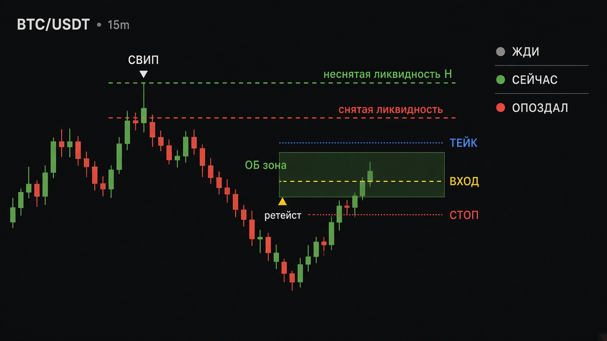
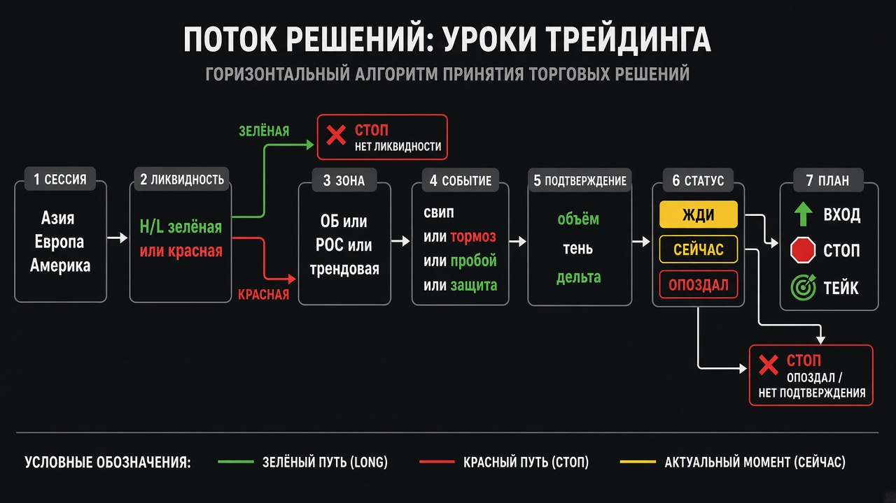

# Плейбук «10 поток»: все уроки → один график

Как стыкуются разборы 2022–2023 и скрипты в `tradingview/`.  
Это **учебный каркас**, не обещание прибыли. Автопроверки паттернов SMC/пробой+ретест в `docs/RESEARCH.md` в массовом виде были в минусе; микс A+B+C с фильтрами — отдельная линия.

Схемы:





---

## 1. Одним абзацем

На графике всегда одна логика:

**сессия → ликвидность → зона → событие → подтверждение → статус ЖДИ/СЕЙЧАС/ОПОЗДАЛ → вход / стоп / тейк.**

Все уроки — разные имена одного пайплайна. Не вешай все индикаторы сразу.

---

## 2. Хронология уроков

| Когда | Урок | Файл дока | Pine |
|---|---|---|---|
| 03.02.2022 | Лента EMA + Zoner % + фильтр в тенях | `lesson_zoner_ribbon_2022-02-03.md` | `lesson_zoner_ribbon.pine` |
| 15.02.2023 | Рынок / лимит + **тормозной бар** | `lesson_market_limit_brake_2023-02-15.md` | `lesson_brake_bar.pine` |
| 17.02.2023 | **Ликвидность**, пробой+ретест, свип | `lesson_liquidity_2023-02-17.md` | `liquidity_lesson.pine`, `liquidity_plan.pine` |
| 19.02 ~19:00 | Live: **MATIC шорт после свипа** | `lesson_matic_short_sweep_2023-02-19.md` | `lesson_matic_short.pine` |
| 19.02 ~20:20 | Live: **LTC пробой трендовой** | `lesson_trendline_break_2023-02-19.md` | `lesson_trendline_break.pine` |
| 20.02.2023 | **Классический ОБ + инсайд** | `lesson_ob_inside_2023-02-20.md` | `ob_inside_lesson.pine` |
| 21.02.2023 | **Speed of Tape** + delta + volume | `lesson_speed_tape_2023-02-21.md` | `lesson_speed_tape.pine` |
| 27.02.2023 | Практика: **ликв + ОБ карта** | `lesson_practice_liq_ob_2023-02-27.md` | `lesson_liq_ob_map.pine` |
| 01.03.2023 | Объёмный уровень + **лимитный игрок** | `lesson_limit_volume_2023-03-01.md` | `lesson_limit_volume.pine` |
| 03.03.2023 | Кластеры DeltaRiver (тени) | `lesson_deltariver_clusters_2023-03-03.md` | `deltariver_clusters_lesson.pine` |
| 06.03.2023 | Setup DR: тень **65%** / тело **90%** | `lesson_deltariver_setup_2023-03-06.md` | `lesson_dr_setup.pine` |
| 08.03.2023 | **Защита уровня** vs пробой | `lesson_level_defense_2023-03-08.md` | `lesson_level_defense.pine` |
| 10.03.2023 | **Сессии** + margin 25/50/100% | `lesson_sessions_margin_2023-03-10.md` | `lesson_sessions_margin.pine` |

Карта сервиса (не урок потока, но тот же язык уровней): `mix_map.pine`.

---

## 3. Слои на графике (легенда)

| Слой | Что видно | Откуда |
|---|---|---|
| Фон сессии | Азия / Европа / Америка | 10.03 |
| Ликвидность | Зелёная = не снята (цель); красная = снята | 17.02, 27.02 |
| Зона | ОБ-бокс, POC/VAL/VAH, трендовая, margin % | 20.02, 01.03, 19.02 TL, 10.03, 08.03 |
| Событие | Свип, тормоз, пробой, защита/отбой, слом IB | 15–21.02, 08.03 |
| Подтверждение | Объём, тень %, плотность Speed, CCI | 21.02, 01.03, 06.03 |
| План | Линии **ВХОД / СТОП / ТЕЙК** + % и R | все «65 …» скрипты |
| Статус | **ЖДИ** · **СЕЙЧАС** · **ОПОЗДАЛ** | общий UX |

Треугольники на истории = **примеры**, не ордер. Ордер только при **СЕЙЧАС**.

---

## 4. Как это должно работать (алгоритм)

```
1. Сессия: не все свечи равны (особенно NY vs Азия).
2. Разметь H/L: куда ещё есть ликвидность (зелёная цель).
3. Найди зону на пути: ОБ / уровень / POC / трендовая / 25–50–100%.
4. Дождись события:
   - защита (отбой от зоны), или
   - пробой (close за зоной), или
   - свип (тень за уровень, close обратно), или
   - тормоз / лимитник в тени.
5. Не путай импульс (тело ≥ ~90%) с отбоем (тень ≥ ~65%).
6. Статус:
   - ЖДИ — события нет;
   - жди цену к зелёной — план есть, цена не у входа;
   - СЕЙЧАС — цена у входа;
   - ОПОЗДАЛ — не догоняй.
7. Стоп за зоной / за свип-экстремумом; тейк к зелёной ликвидности или ~2R.
```

---

## 5. Стартовый стек (что реально вешать)

**Минимум для бумажной торговли (рекомендуется):**

1. `lesson_liq_ob_map.pine` **или** `lesson_level_defense.pine` — карта + план.  
2. Один «свечной» фильтр на выбор: `lesson_brake_bar.pine` / `lesson_dr_setup.pine` / `lesson_matic_short.pine`.  
3. ТФ: **15m**, контекст **1H**.  

**Не вешать вместе:** SpeedTape + DR Setup + brake + limit_volume — они дублируют «тень+объём».

**Позже (контекст):** `lesson_sessions_margin.pine` (фон сессий).  
**Живые кейсы для учёбы:** `lesson_matic_short.pine`, `lesson_trendline_break.pine`.

---

## 6. Соответствие «урок → что делать руками»

| Ситуация на графике | Действие | Скрипт-подсказка |
|---|---|---|
| Длинная тень + объём, close от края | Тормоз / лимитник → план отбоя | brake, limit_volume, DR Setup |
| Хай прокололи тенью, close ниже | Свип → шорт (как MATIC) | matic_short, liquidity |
| Close выше нисходящей TL + объём | Лонг на пробое (как LTC) | trendline_break |
| Импульс от встречной свечи → ретест бокса | ОБ-ретест | ob_inside, liq_ob_map |
| Цена у зоны, отскок | Защита | level_defense |
| Close за зоной | Пробой после факта | level_defense, liquidity_plan |
| Жёлтый бар плотности у зоны | Смотри Speed / дельту | speed_tape (на ATAS сильнее) |

---

## 7. Правила риска (из ваших же выводов)

- Стоп не уже **~0.5%** цены на крипте.  
- Не входи, если до цели меньше **~1.5R**.  
- Не догоняй статус **ОПОЗДАЛ**.  
- Бумага 2–4 недели, журнал: зона / событие / вход / стоп / тейк / итог R.  
- Уроки **не заменяют** микс A+B+C из `docs/STRATEGY.md` — это другой контур.

---

## 8. Ограничения TV vs DeltaRiver / ATAS

На TradingView нет настоящего footprint, DOM, Speed of Tape и liquidation margin.  
Скрипты — **прокси** (геометрия тени, volume/range, пивоты).  
Кластеры, Big Trades, DOM, 5s-ленту отрабатывай в DR/ATAS; на TV учись дисциплине плана и статусов.

---

## 9. Честный итог

| Вопрос | Ответ |
|---|---|
| Можно ли начать торговать по этому? | Да, **на бумаге**, одним стеком и только СЕЙЧАС. |
| Есть ли доказанный edge у сырых алертов? | Нет (см. RESEARCH). |
| Главная польза набора | Единый язык: зона → событие → не mid-air → стоп за зоной. |
| Лучший «суммарный» скрипт | `lesson_liq_ob_map.pine` + один фильтр тени. |
