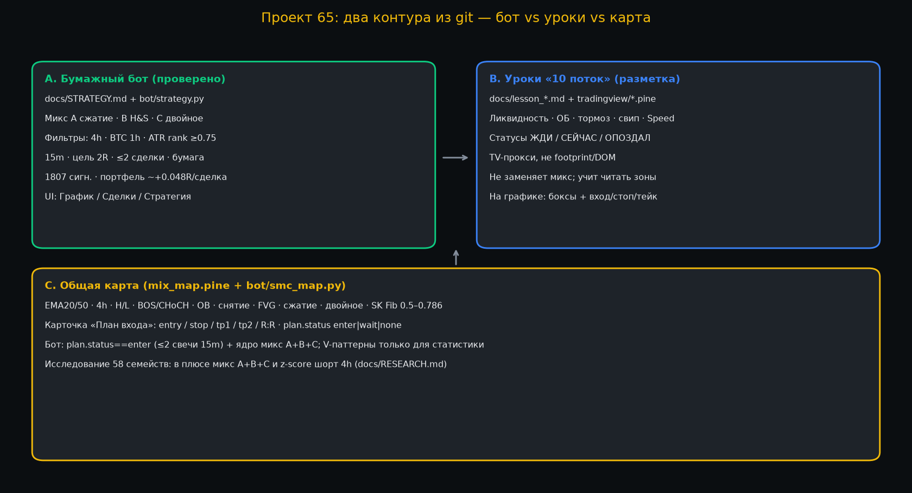
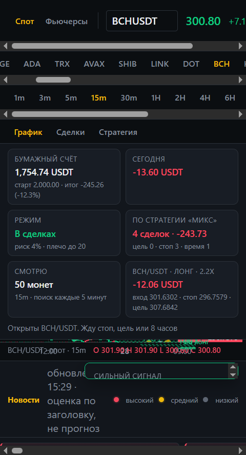
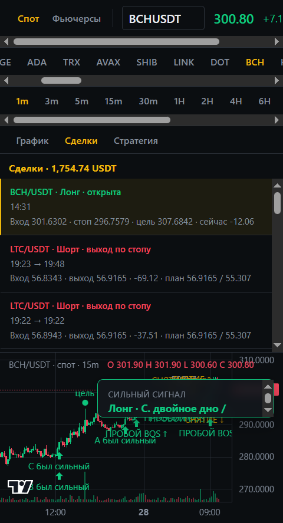
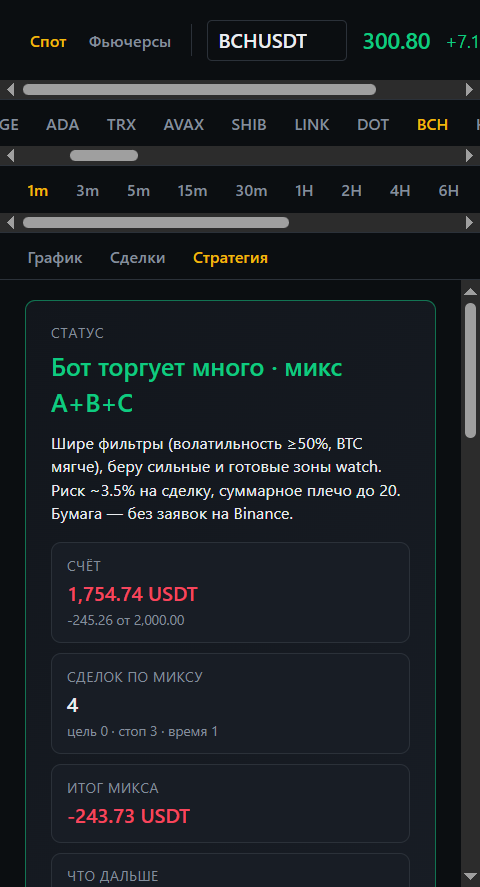
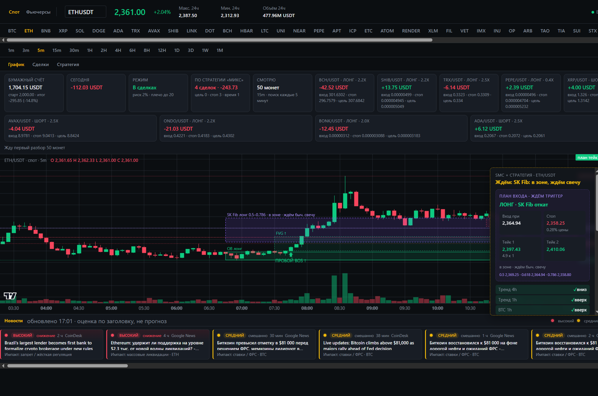
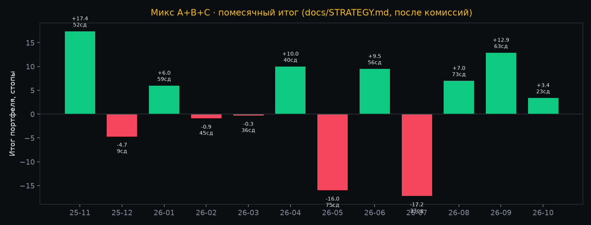
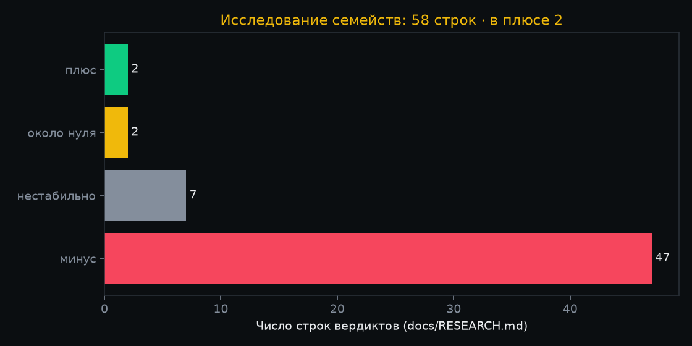
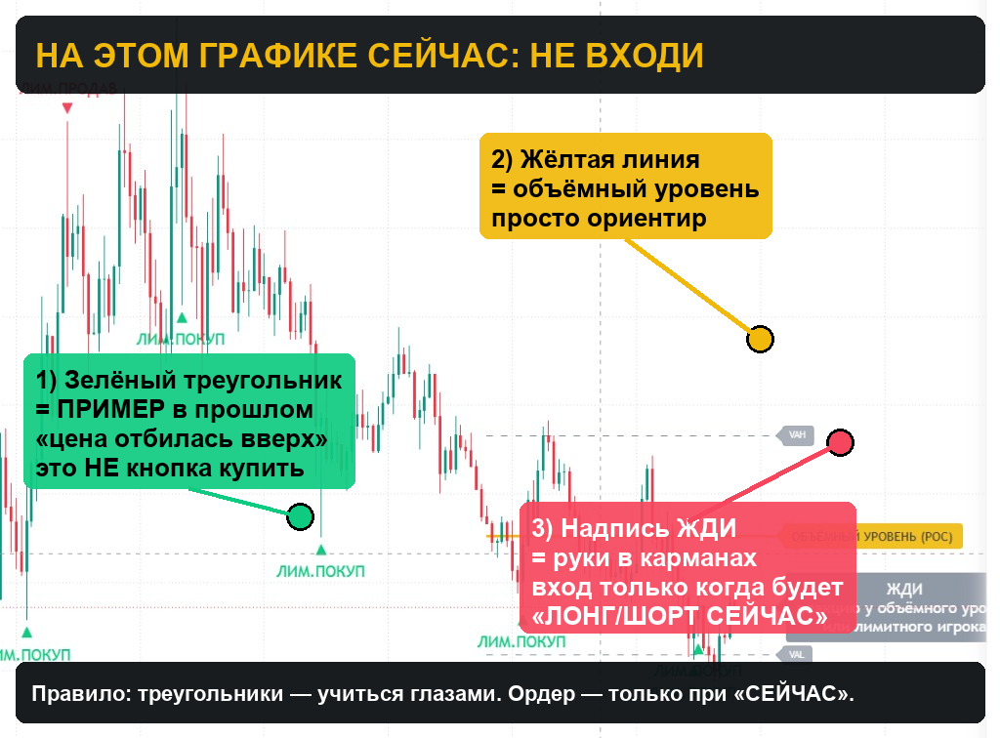

# Плейбук проекта 65: стратегии + график + уроки

Это **полная** карта того, что уже лежит в git — не только уроки Telegram-потока.  
Цифры и скрины ниже из репозитория: `docs/STRATEGY.md`, `docs/RESEARCH.md`, `docs/TRADES.md`, `assets/screens/*`, `bot/`, `tradingview/`.

---

## 0. Карта проекта (два контура + одна разметка)

| Контур | Где в git | Что делает | Статус края |
|---|---|---|---|
| **A. Бумажный бот «микс»** | `bot/strategy.py`, `docs/STRATEGY.md`, UI web | Торгует A/B/C с фильтрами на 15m | Слабый плюс на истории |
| **B. Уроки «10 поток»** | `docs/lesson_*.md`, `tradingview/lesson_*.pine` | Учит читать зоны / лимитку / свип | Учебный каркас, не бэктест |
| **C. SMC-карта** | `tradingview/mix_map.pine`, `bot/smc_map.py` | Рисует уровни, BOS, OB, SK Fib, план | Разметка + кандидаты `plan` |

Без A бот пустой. Без C нет «плана на графике». B не заменяет A.

---

## 1. Реальный UI сервиса (не схема «из воздуха»)

Скрины из `assets/screens/` — рабочий веб-график бота:

### 1.1 График + сильный сигнал (BCH)

На кадре: бумажный счёт, режим «В сделках», карточка открытого **BCH лонг** (вход / стоп / цель), скан **50 монет 15m**, метка **СИЛЬНЫЙ СИГНАЛ**.

### 1.2 Журнал сделок + разметка на 15m

Видно: открытый BCH; закрытые LTC по стопу; на графике подписи вроде **ПРОБОЙ BOS**, **А/С был сильный**, **СИЛЬНЫЙ СИГНАЛ · двойное дно**.

### 1.3 Вкладка «Стратегия»

Текст статуса: бот торгует **микс A+B+C**, риск ~3.5%, плечо до 20×, бумага без ордеров на Binance. На кадре итог микса в минусе по живой серии — это тоже факт проекта, не реклама.

### 1.4 SMC + план входа (ETH)

Живая карта: **SK Fib 0.5–0.786**, **OB long**, **FVG**, **ПРОБОЙ BOS**, справа панель **ПЛАН: ЛОНГ · SK Fib** с ценами вход/стоп/тейк1/тейк2 и трендами 4h/1h/BTC.

---

## 2. Стратегия, которую бот реально торгует: микс A+B+C

Источник правил: `docs/STRATEGY.md`, код: `bot/strategy.py`.

### 2.1 Паттерны ядра

| Буква | Паттерн | Вход | Стоп |
|---|---|---|---|
| **A** | Сжатие и пробой с объёмом | 12 свечей в коридоре ≤2.5 ATR, close за коридором, объём ≥1.5× среднего | за противоположной стороной коридора |
| **B** | Голова и плечи | close за шеей | за правым плечом |
| **C** | Двойное дно / вершина | close за шеей; нужен тренд 1h по ходу | за дном / вершиной |

### 2.2 Когда сигнал «сильный»

Одновременно:

1. тренд **4h** по ходу (EMA20/50);  
2. тренд **BTC 1h** по ходу;  
3. волатильность монеты: ATR-ранг ≥ **0.75** за 30 дней;  
4. для монет «живёт сама» (TRX, QNT, STRK) паттерн **A не торгуется**.

Вход: лимит по close сигнальной 15m, ждать до 30 мин. Цель **2R**, выход по времени (в доке стратегии — 8ч история; в коде `HOLD_HOURS` может отличаться для режима набора). Макс **2** сделки, одна на монету.

### 2.3 Что показала история (не обещание)

Из `docs/STRATEGY.md` (спот Binance, ~год, 50 монет):

- одиночные 15 паттернов после комиссий в **минусе** (цель 2R при ~22–30% попаданий; безубыток ~33%);  
- микс с фильтрами: **1807** сигналов, цель 28%, среднее **+0.17R**;  
- портфель ≤2 сделок: **564** сделок, среднее **+0.048R**, макс серия минусов **11**.

### 2.4 Доп. паттерны «V» (статистика, не ядро)

В `bot/strategy.py` → `VOLUME_PATTERNS`: ордер-блок, BOS-ретест, CHoCH, снятие+FVG, флаг, откат к EMA.  
Нужны для набора сделок/логов, **не** равны проверенному миксу A+B+C.

---

## 3. Исследование всех семейств (до уроков потока)

Источник: `docs/RESEARCH.md` (`python -m bot.research.families`).

- Семейств/строк в таблице: десятки комбинаций ТФ.  
- В плюсе на обучении **и** проверке: **2** (микс A+B+C; z-score шорт 4h).  
- Попадание ≥70%: **0**.

Группы, которые гоняли: смарт-мани, фигуры, пробой, тренд, диапазон, объём, индикаторы, связь с BTC, возврат к среднему.  
Почти весь блок SMC (OB, CHoCH, BOS-ретест, sweep+FVG) на истории **в минусе** — поэтому уроки потока = школа чтения, не автозамена микса.

---

## 4. Бумажный журнал (реальные сделки из git)

Источник: `docs/TRADES.md` (UTC+5). Примеры причин:

- скальп 1m: снятие уровня;  
- откат в имбаланс;  
- **микс A**: сжатие и пробой;  
- **микс C**: двойное дно/вершина (серия LTC стопов на узком стопе — урок риска в RESEARCH).

Снимок счёта в файле: депозит 2000 → ~1837 USDT на дату среза. Это журнал, не live-биржа.

---

## 5. Что рисует карта на TradingView / в сервисе

| Элемент | Смысл | Где |
|---|---|---|
| EMA20/50 + фон 4h | тренд | `mix_map.pine` |
| уровень H/L | структура | mix_map / smc_map |
| ПРОБОЙ BOS / СМЕНА CHoCH | слом | mix_map |
| OB лонг/шорт | ордер-блок | mix_map |
| СНЯТИЕ / FVG | ликвидность / имбаланс | mix_map |
| сжатие / двойное | фигуры микса | mix_map |
| SK Fib зона 0.5–0.786 | откат по импульсу | mix_map + README |
| ПЛАН вход/стоп/tp1/tp2 | единая подсказка | mix_map `plan` / UI |

`plan.status`: `enter` | `wait` | `none`. Бот может брать `enter` не старше 2 свечей 15m как кандидата рядом с A+B+C.

---

## 6. Уроки «10 поток» — куда они стыкуются

Не отдельный «грааль», а словарь для глаза поверх карты:

| Урок | Дата | Pine | Стык с проектом |
|---|---|---|---|
| Zoner + лента | 03.02.2022 | `lesson_zoner_ribbon.pine` | % пути ≈ цели/стопы |
| Тормозной бар | 15.02.2023 | `lesson_brake_bar.pine` | лимитка в тени |
| Ликвидность | 17.02.2023 | `liquidity_*.pine` | снятие / ретест |
| MATIC свип | 19.02.2023 | `lesson_matic_short.pine` | live-кейс свипа |
| LTC трендовая | 19.02.2023 | `lesson_trendline_break.pine` | live-кейс пробоя |
| ОБ + инсайд | 20.02.2023 | `ob_inside_lesson.pine` | OB на карте |
| Speed of Tape | 21.02.2023 | `lesson_speed_tape.pine` | плотность (прокси) |
| Практика ликв+ОБ | 27.02.2023 | `lesson_liq_ob_map.pine` | сводная карта урока |
| Лимит+объём | 01.03.2023 | `lesson_limit_volume.pine` | POC / лимитник |
| Кластеры DR | 03.03.2023 | `deltariver_clusters_lesson.pine` | order-flow школа |
| DR Setup 65%/90% | 06.03.2023 | `lesson_dr_setup.pine` | отбой vs импульс |
| Защита уровня | 08.03.2023 | `lesson_level_defense.pine` | hold vs break |
| Сессии + маржа | 10.03.2023 | `lesson_sessions_margin.pine` | время + % зоны |

### Как читать учебный Pine (реальный аннот. скрин)

Правило проекта: треугольники = **примеры**; ордер только при **СЕЙЧАС**.

Ещё how-to: `assets/screens/lesson_limit_volume_howto.jpg`.

---

## 7. Как это должно выглядеть «в работе» (практический стек)

### Вариант 1 — торговать как бот (рекомендуется для денег/бумаги)

1. Запустить сервис (`start.sh` / `python -m bot.server`).  
2. Вкладки **График / Сделки / Стратегия**.  
3. Входы только по **сильным** сигналам микса A+B+C (или `plan.enter` с теми же фильтрами).  
4. Риск 1–2% на сделку; стоп не уже ~0.5% цены.  
5. Вести журнал как в `TRADES.md`.

На TV для глаз: один `mix_map.pine` (не пачка lesson_*).

### Вариант 2 — учиться по урокам потока

1. `lesson_liq_ob_map` **или** `lesson_level_defense` + **один** фильтр тени.  
2. ТФ 15m / 1H.  
3. Только **СЕЙЧАС**.  
4. Не смешивать с автоторговлей бота без журнала отдельно.

### Вариант 3 — запрещённый шум

Все `lesson_*.pine` + Speed + DR + brake + limit разом + торговля каждого треугольника.  
Это гарантированный шум; SMC-семейства в RESEARCH уже показали минус.

---

## 8. Связь «урок → бот» одной фразой

| Идея урока | Уже есть в проекте? |
|---|---|
| Ликвидность / свип | да → снятие на карте; sweep_fvg в V (минус в исследовании) |
| ОБ / ретест | да → OB на карте; order_block V (минус) |
| Пробой + ретест | да → BOS/CHoCH, range_retest (минус); микс A ближе к пробою с фильтрами |
| Лимитник / тормоз / кластер | частично на TV-прокси; полный смысл в DR/ATAS |
| Сессии / margin % | только lesson pine; бот это не фильтрует |
| План вход/стоп/тейк | да → UI + `plan` + микс уровни |

**Вывод:** торговый край проекта = **микс A+B+C с фильтрами**. Уроки = язык разметки и дисциплина СЕЙЧАС/ОПОЗДАЛ. Карта `mix_map` = мост между ними на графике.

---

## 9. Чеклист перед сделкой (общий)

1. Это сигнал **микса** (A/B/C) или только метка урока?  
2. 4h и BTC 1h по ходу? ATR-ранг ок?  
3. Стоп ≥ ~0.5% цены? До цели ≥ ~1.5R?  
4. Нет статуса ОПОЗДАЛ / mid-air?  
5. Записано в журнал?

---

## 10. Файлы-источники

| Файл | Роль |
|---|---|
| `docs/STRATEGY.md` | правила и цифры микса |
| `docs/RESEARCH.md` | 58 семейств |
| `docs/TRADES.md` | бумажный журнал |
| `PLAN.md` | архитектура сервиса |
| `bot/strategy.py` | код микса + V |
| `bot/smc_map.py` | карта/plan для API |
| `tradingview/mix_map.pine` | TV-карта |
| `tradingview/lesson_*.pine` | учебные индикаторы |
| `assets/screens/*` | реальные скрины UI и аннотации |
