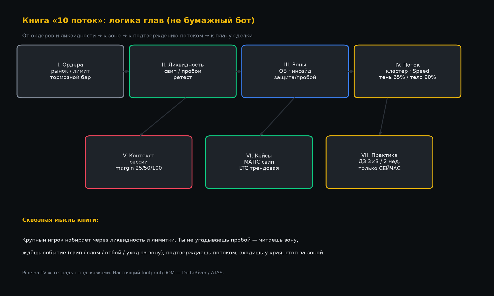
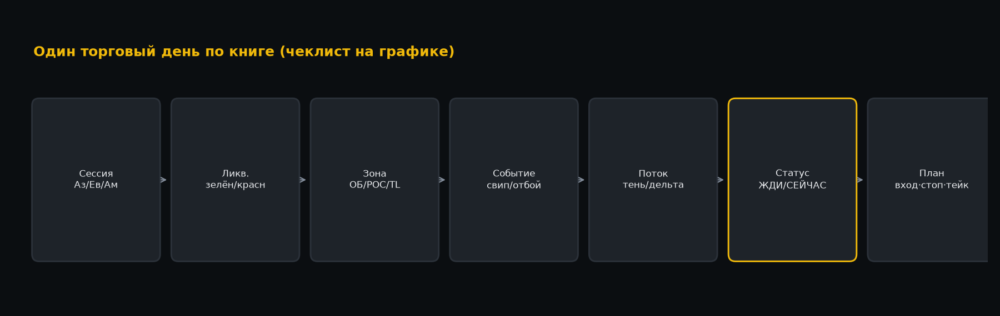
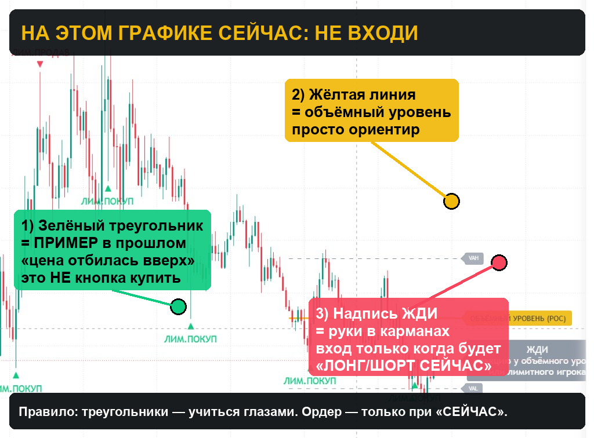

# Книга «10 поток»: ликвидность, зоны, поток и план сделки

Собрано из записей стримов Telegram-группы **«10 поток»** (2022–2023) и их разборов в `docs/lesson_*.md`.  
Платформы на уроках: **TradingView**, **DeltaRiver**, местами **ATAS / Tiger**.  
Pine в `tradingview/` — **тетрадь**: чтобы повторять на графике, не «кнопка купить».

> Это черновик **учебной книги по чтению рынка**, а не отчёт бумажного бота и не обещание прибыли.  
> Бумажный микс / RESEARCH / UI-сервис в эту книгу **не входят** — отдельный контур проекта.

Схемы глав:

---

## Введение: о чём эта книга

Поток учил не «индикаторной магии», а одной истории:

1. За экстремумами сидит **ликвидность** (стопы, тейки, ордера на пробой и на отбой).  
2. **Крупный игрок** часто набирает через снятие этой ликвидности и через **лимитные** стенки.  
3. Твоя работа — увидеть **зону**, дождаться **события** (свип / слом / отбой / уход за зону), по возможности подтвердить **потоком** (дельта, кластер, скорость ленты), войти **у края**, стоп **за зоной**.  
4. Не догонять импульс «в воздухе». Если опоздал — жди новый сетап.

Книга идёт от простого к сложному так же, как шли уроки: сначала ордера и тормоз, потом ликвидность, потом ОБ, потом order-flow, потом защита уровня и сессии, плюс два живых кейса.

---

## Глава I. Ордера: рынок, лимит и тормозной бар

**Урок:** 15.02.2023 · `lesson_market_limit_brake_2023-02-15.md` · Pine: `lesson_brake_bar.pine`

### Контекст

Пока не ясно, чем рыночный ордер отличается от лимитного, любые «кластеры» бессмысленны. На схеме DOM: сверху лимитные продажи (Ask), снизу покупки (Bid), посередине спред — туда бьёт рынок.

| Ордер | Когда исполняется | Роль в картине |
|---|---|---|
| **Рыночный** | Сейчас, по цене стакана | Агрессия, двигает цену |
| **Лимитный** | Когда цена *дойдёт* до твоей цены | Стенка, «тормоз», защита уровня |

### Тормозной бар

Свеча пыталась уйти, но лимитка остановила:

- зелёная свеча + **длинная верхняя тень** → лимитка **продаж** сверху → намёк на слабость лонга / идея шорта;  
- красная + **длинная нижняя тень** → лимитка **покупок** снизу → намёк на лонг.

Это ещё не вход. Это язык: «здесь кто-то стоял лимитом».

**Практика на TV:** статус ЖДИ / СЕЙЧАС / ОПОЗДАЛ. Треугольники на истории — примеры исхода плана, не ордера.

---

## Глава II. Ликвидность: что собирает цена

**Урок:** 17.02.2023 · `lesson_liquidity_2023-02-17.md` · Pine: `liquidity_lesson.pine`, `liquidity_plan.pine`

### Определение с доски урока

Ликвидность — это:

1. стопы участников;  
2. тейки участников;  
3. ордера на пробой;  
4. ордера на отбой.

За хаями и лоями всё это «висит». Цена часто **протыкает** уровень тенью (собирает) и возвращается.

### Два сетапа

**A. Пробой + ретест**  
Close за уровнем → ждать возврат → вход от бывшего сопротивления как поддержки (лонг) или зеркально. Стоп за уровнем. Цель — следующий пул ликвидности.

**B. Свип (ложный пробой / upthrust)**  
Тень за уровень, close обратно → вход против свипа, стоп за экстремумом свипа.

### ДЗ потока

**3 актива × 3 ТФ** — разметить руками: где ликвидность снята, где ещё есть.

Без этой главы ОБ и кластеры «висят в воздухе»: непонятно, *зачем* цена ходила за уровень.

---

## Глава III. Зоны: классический ОБ и инсайд-бар

**Урок:** 20.02.2023 · `lesson_ob_inside_2023-02-20.md` · Pine: `ob_inside_lesson.pine`  
**Практика:** 27.02.2023 · `lesson_practice_liq_ob_2023-02-27.md` · `lesson_liq_ob_map.pine`

### Классический ОБ

Последняя встречная свеча / база перед сильным импульсом. Часто перед импульсом — sweep тенью.  
**Не гнаться за импульсом.** Ждать ретест края зоны.  
Лонг: вход у **верха** бокса, стоп под **низом** (и зеркально для шорта).

### Инсайд-бар → ОБ

Mother → inside (high/low внутри) → слом диапазона mother импульсом → диапазон mother становится зоной ОБ → снова ретест.

На схемах урока бокс = **весь диапазон mother** (не только тело inside) — так зафиксировано по кадрам; голос мог уточнять.

### Легенда практики 27.02 (SUSHI и др.)

- **Зелёные** уровни — ликвидность ещё не снята (цели).  
- **Красные** — уже снята.  
- ОБ / инсайд — зоны интереса.  
- Тейк — к ближайшей зелёной по направлению.

Вопрос из чата (Evgeniy): вход на ретесте или сразу на развороте?  
На схемах акцент — **ретест**.

---

## Глава IV. Защита уровня vs пробой

**Урок:** 08.03.2023 · `lesson_level_defense_2023-03-08.md` · Pine: `lesson_level_defense.pine`

После того как зона найдена, остаётся главный вопрос дня:

> Уровень **держат** лимитником — или цена **уже ушла** под/над него?

| Сценарий | Картинка | Действие | Стоп |
|---|---|---|---|
| **Защита** | Отбой от зоны, поток «держит» | Вход в сторону удержания | За противоположный край зоны |
| **Пробой** | Close **за** зоной | Вход **после** ухода, не догадываясь | Обратно в зону / за свинг |

На DeltaRiver смотрели POC H4/D1/W1 как магниты. На TV в скриптах — прокси и статусы **ЖДИ / СЕЙЧАС / ОПОЗДАЛ** (не mid-air).

Автоtrade на уроке («Нехочуха» по CCI, «Поглощение») — **фильтры терминала**, не ядро книги. Ядро — защита vs пробой.

---

## Глава V. Поток: кто стоит в тени свечи

Сюда сходятся несколько уроков — это «микроскоп» после макро-зоны.

### 1) Лимитный игрок и объёмный уровень (01.03.2023)

`lesson_limit_volume_2023-03-01.md` · `lesson_limit_volume.pine`

- Верх свечи ↔ покупки-агрессия; низ ↔ продажи.  
- Огромные покупки **вверху**, цена не ушла выше → лимитный **продавец** съел бай.  
- Огромные продажи **внизу**, цена не упала → лимитный **покупатель**.  
- Плюс POC / VAL / VAH профиля как ориентиры реакции.

Правило книги: треугольники — **учиться глазами**. Ордер — только когда статус **СЕЙЧАС**.

### 2) Кластеры DeltaRiver (03.03.2023)

`lesson_deltariver_clusters_2023-03-03.md` · `deltariver_clusters_lesson.pine`

ДЗ: любой альт **кроме BTC/ETH**, M15, **2 недели**, отстроить кластера.  
Фильтр: SellΔ в нижней тени → идея лонга; BuyΔ в верхней → идея шорта.  
Пороги **под монету** (ADA ≠ LINK). Это не «каждый квадратик».

### 3) Speed of Tape (21.02.2023)

`lesson_speed_tape_2023-02-21.md` · `lesson_speed_tape.pine`

Скорость ленты + Volume + Delta у зоны:  
пик у края зоны + встречная дельта → разворот;  
скорость + дельта по ходу → продолжение.  
На ATAS смотрели до **5s**; на TV — суррогат плотности `volume/range`.

### 4) Setup DR: тень 65% / тело 90% (06.03.2023)

`lesson_deltariver_setup_2023-03-06.md` · `lesson_dr_setup.pine`

Жёсткое различение:

- тень ≥ **65%** + объём → климакс в тени → **отбой**;  
- тело ≥ **90%** + объём → **импульс**, не путать с тормозом.

Без этого фильтра новичок шортит каждый зелёный «вынос» и лонгует каждый красный — и ловит продолжение тренда.

---

## Глава VI. Контекст времени и маржинальные зоны

**Урок:** 10.03.2023 · `lesson_sessions_margin_2023-03-10.md` · `lesson_sessions_margin.pine`  
**Корни:** 03.02.2022 · `lesson_zoner_ribbon_2022-02-03.md` · `lesson_zoner_ribbon.pine`

### Сессии

Крипта 24/7, но всплески часто совпадают с Азией / Европой / Америкой.  
Смотри не «все свечи подряд», а **в какой сессии** случилось событие у зоны.

### Margin / Zoner %

От базы импульса — лестница **25 / 50 / 100%** (или Zoner 0…100 + стопы −20 / 120).  
Это магниты реакции и карта целей, не вход из середины воздуха.  
На TV — геометрический прокси; на Tiger/ATAS — их margin zones; это не биржевой liquidation calc в Pine.

---

## Глава VII. Живые кейсы (один вечер, два разбора)

### MATIC шорт после свипа (~19:00, 19.02.2023)

`lesson_matic_short_sweep_2023-02-19.md` · `lesson_matic_short.pine`

1. Памп.  
2. Свип хая ~1.536.  
3. Отбой.  
4. Шорт ~1.5338, стоп 1.5395, тейк 1.5221 (~**2R**), стоп потом подтянули в плюс.

Учебный разбор **одной** сделки, не правило «всегда шортить свип».

### LTC пробой нисходящей трендовой (~20:20, тот же день)

`lesson_trendline_break_2023-02-19.md` · `lesson_trendline_break.pine`

Сжатие под нисходящей синей → пробой вверх с объёмом → подтверждение CCI / MACD_LB и дельты на DR → лонг, стоп под базу, цель к прошлым хаям (~100.5–101 → 103.5–105 на кадрах).

Два кейса рядом показывают вилку книги: **свип → против** и **чистый пробой → по ходу**.

---

## Глава VIII. Как читать график по этой книге (ежедневный ритуал)

1. **Сессия** — какая сейчас и типична ли активность.  
2. **Ликвидность** — зелёная (цель) / красная (снята).  
3. **Зона** — ОБ, mother после IB, POC, трендовая, 25–50–100%.  
4. **Событие** — свип, тормоз, отбой-защита, close за зоной, слом IB.  
5. **Поток** — тень vs тело (65/90), дельта/кластер/Speed если есть DR/ATAS.  
6. **Статус** — ЖДИ / жди цену к входу / СЕЙЧАС / ОПОЗДАЛ.  
7. **План** — вход у края, стоп за зоной, тейк к неснятой ликвидности или понятной R-кратности.

Если шага 4 нет — нет сделки. Если шаг 6 = ОПОЗДАЛ — нет сделки.

---

## Глава IX. Домашние задания потока (как учиться)

| ДЗ | Смысл |
|---|---|
| 3 актива × 3 ТФ — ликвидность | Набить глаз на «собрали / ещё есть» |
| Альт ≠ BTC/ETH, M15, 2 недели — кластера | Настроить пороги под монету, не копировать чужие |
| Разметка теней со снятием стопов | Связать главу I–II с живым графиком |

Книга без ДЗ остаётся PDF в голове. Pine помогают проверить, *узнаёшь ли* формацию, но не заменяют ручную разметку.

---

## Глава X. Честность: чего книга не даёт

- Фиксированного винрейта и «святого» RR (на схемах часто удобный ориентир ~2R).  
- Универсальных порогов объёма/дельты на все монеты.  
- Полной копии DeltaRiver/ATAS на TradingView.  
- Автоматической торговли «по всем алертам Pine».  
- Замены мышления: скрипт пишет СЕЙЧАС — ты всё равно проверяешь зону и сессию.

Голос преподавателя на части записей не расшифрован; где схемы и чат однозначны — так и зафиксировано в `lesson_*.md`. Где был только голос — в книге стоит пометка «открытый нюанс».

---

## Приложение A. Словарь

| Термин | Глава | Коротко |
|---|---|---|
| Ликвидность | II | стопы/тейки/пробой/отбой за H/L |
| Свип | II, VII | тень за уровень, close обратно |
| Тормозной бар | I | тень = след лимитки |
| ОБ | III | база перед импульсом → ретест |
| Инсайд / mother | III | сжатие → слом = зона |
| Защита / пробой | IV | держат vs ушли за зону |
| Лимитный игрок | V | поглощение в тени |
| POC / VAH / VAL | V, IV | профиль объёма |
| Speed of Tape | V | скорость сделок у зоны |
| Сессия | VI | Азия / Европа / Америка |
| Margin / Zoner % | VI | лестница 25–100% от импульса |

## Приложение B. Файлы уроков → Pine

| Дата | Док | Индикатор |
|---|---|---|
| 03.02.2022 | `lesson_zoner_ribbon_2022-02-03.md` | `lesson_zoner_ribbon.pine` |
| 15.02.2023 | `lesson_market_limit_brake_2023-02-15.md` | `lesson_brake_bar.pine` |
| 17.02.2023 | `lesson_liquidity_2023-02-17.md` | `liquidity_lesson.pine`, `liquidity_plan.pine` |
| 19.02.2023 | `lesson_matic_short_sweep_2023-02-19.md` | `lesson_matic_short.pine` |
| 19.02.2023 | `lesson_trendline_break_2023-02-19.md` | `lesson_trendline_break.pine` |
| 20.02.2023 | `lesson_ob_inside_2023-02-20.md` | `ob_inside_lesson.pine` |
| 21.02.2023 | `lesson_speed_tape_2023-02-21.md` | `lesson_speed_tape.pine` |
| 27.02.2023 | `lesson_practice_liq_ob_2023-02-27.md` | `lesson_liq_ob_map.pine` |
| 01.03.2023 | `lesson_limit_volume_2023-03-01.md` | `lesson_limit_volume.pine` |
| 03.03.2023 | `lesson_deltariver_clusters_2023-03-03.md` | `deltariver_clusters_lesson.pine` |
| 06.03.2023 | `lesson_deltariver_setup_2023-03-06.md` | `lesson_dr_setup.pine` |
| 08.03.2023 | `lesson_level_defense_2023-03-08.md` | `lesson_level_defense.pine` |
| 10.03.2023 | `lesson_sessions_margin_2023-03-10.md` | `lesson_sessions_margin.pine` |

## Приложение C. Минимальный набор на графике для учёбы

1. `lesson_liq_ob_map.pine` **или** `lesson_level_defense.pine` — зона и план.  
2. Один поток-фильтр: `lesson_brake_bar` / `lesson_dr_setup` / `lesson_limit_volume`.  
3. По желанию фон сессий: `lesson_sessions_margin`.  
4. ТФ: **15m** + контекст **1H/4H**.  
5. Ордер только при **СЕЙЧАС**.

---

*Конец черновика книги. Следующий слой глубины — расшифровка голоса записей и разбор ДЗ учеников кадр-за-кадром; это увеличит «книжность» сильнее, чем любой новый Pine.*
